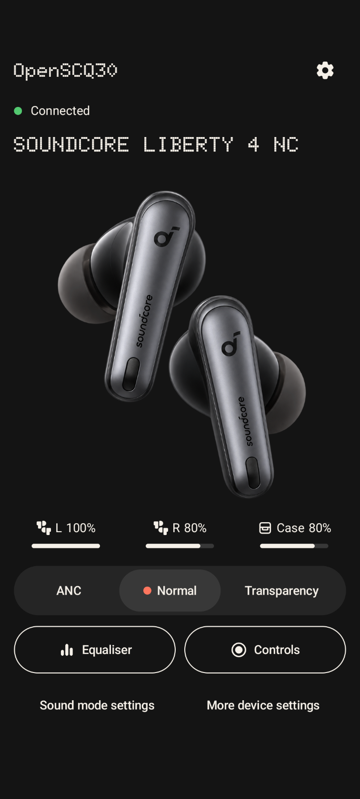

## About

This project is a Nothing OS inspired remix of the original [OpenSCQ30](https://github.com/Oppzippy/OpenSCQ30), which provides controls for Soundcore headphones and earbuds. This remix currently supports the **Soundcore Liberty 4 NC** on Android only.

### Screenshot

### Supported Platforms
 
[x] Android - Ready

### Supported Devices

This remix currently supports the following device:

| Model  | Name                         |
| ------ | ---------------------------- |
| A3947  | Soundcore Liberty 4 NC       |

### Code

See [docs/development.md](docs/development.md)
